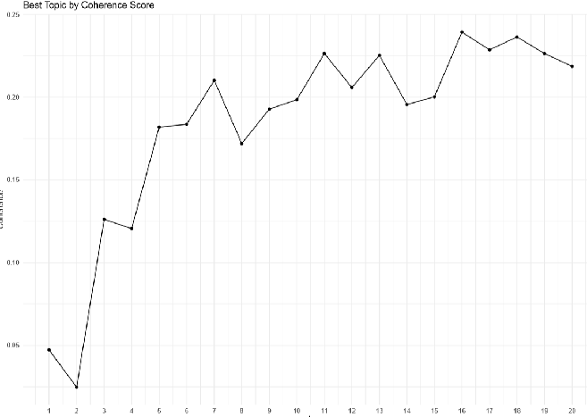
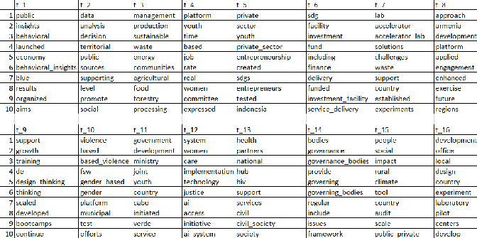
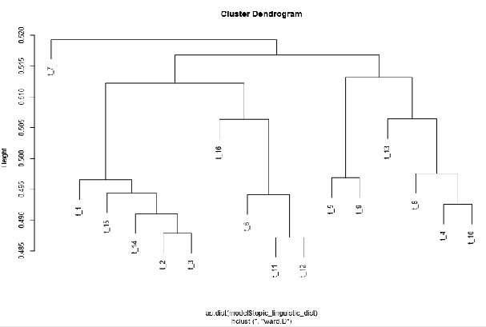

# What do UNDP's innovation projects talk about? LDA topic modelling (2020)

A step by step guide I wrote at UNDP in July 2020 for colleagues who wanted to sort free-text project descriptions by theme without reading them all by hand. It uses **Latent Dirichlet Allocation (LDA)** in R to find the topics in UNDP country offices' descriptions of their innovation work.

**Full walkthrough with formulas:** [owangie.github.io/writing/lda-topic-modelling-undp](https://owangie.github.io/writing/lda-topic-modelling-undp/)

> **Data note.** The underlying UNDP project descriptions are internal and are not included here, nor are screenshots of them. The script runs on any table with an `ID` column and an English text column. The figures below are aggregate outputs of the 2020 run.

## Steps

1. **One language.** Descriptions came in several languages. `=DETECTLANGUAGE()` and `=GOOGLETRANSLATE()` in a spreadsheet translated them into English, then each description was split into paragraphs, one per row.
2. **Clean.** Remove numbers, punctuation, stop words, and words that are everywhere in this corpus but say nothing (*UNDP*, *support*, *develop*, country names).
3. **Document-term matrix.** Unigrams and bigrams, so *accelerator lab* stays one term. Drop terms that appear once or in more than half of paragraphs.
4. **Choose K.** Fit LDA for K = 1 to 20 and score each by probabilistic coherence, the mean of P(b | a) − P(b) over each topic's top words.
5. **Read the topics.** List each topic's ten most probable words (highest φ).
6. **Compare topics.** Hellinger distance between topics' word distributions, clustered with Ward linkage.

## Results of the 2020 run

| Coherence by number of topics | Top ten terms, 16 topics |
|---|---|
|  |  |

Sixteen topics scored highest. Several name themselves: accelerator labs, youth entrepreneurship, gender-based violence, health and HIV, governance bodies, climate and rural communities.



The dendrogram pairs some topics (t_2 with t_3, t_11 with t_12, t_5 with t_9, t_4 with t_10), but their word lists show they cover different things, so all 16 were kept.

## Run it

```r
install.packages(c("textmineR", "tidytext", "dplyr", "tidyr", "readxl", "ggplot2", "SnowballC"))
source("lda_topic_model.R")   # expects innovation_descriptions.xlsx with ID and Cleaned_Translation
```

## References

- Blei, D. M., Ng, A. Y. and Jordan, M. I. (2003). Latent Dirichlet Allocation. *Journal of Machine Learning Research*, 3, 993–1022.
- [textmineR](https://cran.r-project.org/package=textmineR): CreateDtm, FitLdaModel, CalcProbCoherence, CalcHellingerDist.
- [Text mining with R: topic models](https://books.psychstat.org/textmining/topic-models.html).

## Author

On Ki Wong (Angie). Written at UNDP, New York, July 2020.
